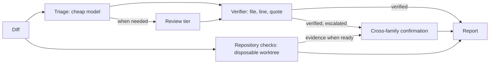

# Quorum

A quorum of AI reviewers for your pull requests. It reports only findings it can verify in your code.

[](https://www.npmjs.com/package/quorum-qa)
[](https://github.com/isanchez-aguilar/quorum-qa/actions/workflows/ci.yml)
[](https://github.com/isanchez-aguilar/quorum-qa/blob/main/LICENSE)
[](https://github.com/isanchez-aguilar/quorum-qa/blob/main/package.json)

<p align="center">
  
</p>
<p align="center"><sub>A real run on a synthetic repository, with excerpts and the 26 s wait sped up. <a href="https://github.com/isanchez-aguilar/quorum-qa/blob/main/docs/demo/README.md">How it was made</a>.</sub></p>

## The problem

A single AI reviewer can hallucinate files, cite the wrong lines, and flood a pull request with noise.
A confident comment does not tell you whether its evidence exists in your code.
You end up checking the reviewer before you can fix the bug.
Quorum automates that evidence check and brings in another model family when a finding needs confirmation.

## What Quorum does differently

- **Several model families, one cascade:** Gemini through Antigravity, Codex, Claude Code, and optional local Qwen, according to your configuration and availability.
- **Evidence checked against your repository:** every code finding's file, line and quote are verified (nearby line errors can be corrected), or dropped from the findings.
- **Independent confirmation for BLOCKERs:** a second model family must confirm them to count as confirmed; unavailable confirmation is explicitly reported. Opt into `--reproduce` to attempt proof with a failing test in an offline container.
- **Your existing tools:** uses your CLI logins and subscriptions, with no API keys requested or stored by Quorum. Providers run read-only; local Qwen uses an optional local model server.
- **Bounded calls:** small reviews can take a few calls; `--dry-run` shows models, planned calls and the call/time budget before you spend quota. Actual calls depend on retries and escalation.

Verification checks that the cited evidence exists; it does not prove every diagnosis correct. Dropped output is kept separately and labelled unverified.

## A 60-second quick start

You need Node 22+, Git, and the configured provider CLIs installed and signed in.

Once per repository, on the base branch:

```sh
npm install --global quorum-qa
cd your-repo
quorum init            # writes quorum.config.json and adds .quorum/ to .gitignore
quorum doctor          # checks the provider CLIs and login readiness
git add quorum.config.json .gitignore
git commit -m "chore: configure Quorum"
git push origin main
```

Then, on any branch with changes:

```sh
quorum review --diff origin/main...HEAD --dry-run   # models, calls, budget; spends nothing
quorum review --diff origin/main...HEAD
```

The config has to be on the base branch because Quorum reads it from the merge-base, so a pull request cannot silently replace your check commands. Follow the [adoption guide](https://github.com/isanchez-aguilar/quorum-qa/blob/main/docs/USING-QUORUM-ON-A-REPO.md) for provider permissions and setup. `doctor --probe` additionally tests authenticated reads and spends quota.

## What a report looks like

Synthetic excerpt; the file, code and finding below are made up. Headings and fields follow the [Markdown reporter](https://github.com/isanchez-aguilar/quorum-qa/blob/main/src/reporters/index.ts).

```markdown
## Blockers

None.

## Important Findings

### 1. A zero balance skips invoice settlement
- **Location:** src/billing.ts:42 (introduced)
- **Severity:** IMPORTANT · **Confidence:** 0.9 · codex:default (openai)
- **Impact:** Fully paid invoices remain open when the remaining balance is zero.
- **Evidence Quote:** if (remainingBalance) settleInvoice();
- **Proposed Fix:** Settle the invoice when remainingBalance === 0.

## Optional Findings

None.
```

## How it works

The diff goes to a cheap triage model first; the review tier handles fallbacks and additional passes when needed.
Every finding is checked by the verifier as soon as it arrives: a finding whose file, line or quote is not in the code is dropped before any further quota is spent on it.
Only verified BLOCKERs and other escalated findings go to another model family for confirmation, and deduplicated findings become the report.
Configured repository checks run in parallel with triage in a separate disposable worktree; confirmation waits for their results.
Checks execute the reviewed code; use `--no-checks` for untrusted changes. See the [safety model](https://github.com/isanchez-aguilar/quorum-qa/blob/main/docs/REFERENCE.md#safety-model).



## Benchmarks

On the bundled `bench/` synthetic suite, the reported run on **2026-10-24** found all eight seeded defects with no findings on the four clean controls. **Twelve synthetic cases are a small sample**, not evidence of the same accuracy on your code. See [benchmark methodology and results](https://github.com/isanchez-aguilar/quorum-qa/blob/main/docs/BENCHMARKS.md).

| Seeded defects found | Findings on clean controls | Provider calls | Time |
|---|---|---|---|
| 8 / 8 | 0 across 4 controls | 22 | About 5 minutes |

To rerun from a source checkout: `pnpm install`, `pnpm build`, then `node bench/run.mjs --dry-run` to preview the budget. When ready to spend provider quota, run `node bench/run.mjs --config quorum.config.json --repeat 1`.

## Comparison

“Single AI reviewer” means one model without an additional verification pipeline; individual tools may add their own features.

| Capability | Single AI reviewer | Quorum |
|---|---|---|
| Several model families | One family | Configurable cascade across families |
| Verification against code | Depends on the tool | File, line and quote checked in code findings |
| Second-family confirmation of BLOCKERs | Requires another reviewer | Built-in; missing confirmation is labelled |
| Proof by failing test | Depends on the tool | Opt-in isolated reproduction lane |
| Runs locally with your CLIs | Depends on the tool | Yes, using your logins |
| Cost shown before running | Depends on the tool | Call/time budget with `--dry-run`, not a dollar quote |

## FAQ

**What does it cost?** Quorum uses your existing provider quotas; usage depends on the models, diff size, retries and escalation. `--dry-run` previews the plan and budget without inference. Optional local Qwen uses your own hardware.

**What is sent to providers?** The diff and review context go to the providers you configure through their CLIs (or your local Qwen endpoint). Context can include source excerpts, specifications, rules and check results. Image review can also send supplied images or captured screenshots. Quorum does not route reviews through a separate hosted Quorum service; see [data and safety details](https://github.com/isanchez-aguilar/quorum-qa/blob/main/docs/REFERENCE.md).

**Does it need API keys?** No. Quorum uses your CLI logins and never requests or stores API keys.

**Which operating systems?** Windows and Linux are tested in CI with fake providers. macOS is not verified yet; real-provider validation is currently documented for Windows in the [reference](https://github.com/isanchez-aguilar/quorum-qa/blob/main/docs/REFERENCE.md#status).

**Can it run in CI?** A dedicated GitHub Action is planned. The current CLI needs the provider tooling and authentication you configure; see the [roadmap](https://github.com/isanchez-aguilar/quorum-qa/blob/main/docs/ROADMAP.md).

## Documentation

- [Reference: modes, flags, safety, budgets, configuration and source/plugin installation](https://github.com/isanchez-aguilar/quorum-qa/blob/main/docs/REFERENCE.md)
- [Using Quorum on a repository](https://github.com/isanchez-aguilar/quorum-qa/blob/main/docs/USING-QUORUM-ON-A-REPO.md)
- [Benchmarks](https://github.com/isanchez-aguilar/quorum-qa/blob/main/docs/BENCHMARKS.md)
- [Changelog](https://github.com/isanchez-aguilar/quorum-qa/blob/main/CHANGELOG.md)
- [Security policy](https://github.com/isanchez-aguilar/quorum-qa/blob/main/SECURITY.md)
- [Contributing](https://github.com/isanchez-aguilar/quorum-qa/blob/main/CONTRIBUTING.md)

Licensed under [Apache-2.0](https://github.com/isanchez-aguilar/quorum-qa/blob/main/LICENSE). See the [trademark policy](https://github.com/isanchez-aguilar/quorum-qa/blob/main/TRADEMARKS.md) for the project name.
